<!-- Header -->

  

  

  
  
  
  

---

## 👨‍💻 About me

I'm a software engineer in Dubai with **7+ years** of building mobile apps, from first sketch to App Store and Google Play. Most of my work is **Flutter**, backed by native **Swift** and **Kotlin** when a feature needs it, and I build the admin panels and APIs behind my apps too.

- 📱 Ship cross-platform apps with Flutter, Riverpod, GetX and clean architecture
- 🧩 Build the backend and dashboards: TypeScript, PHP/Laravel, Firebase, SQL
- 🎨 Work from Figma and Adobe XD designs straight to production UI
- 💬 Ask me about **Flutter, mobile architecture, Android, iOS**

## 🛠️ Tech stack

**Mobile**

  

**Backend & data**

  

**Tools & design**

  

## 📊 GitHub stats

> Most of my work lives in private client repositories. These cards are generated daily by a GitHub Action and include private work (aggregate numbers only).

  
  

  

  

  <picture>
    <source media="(prefers-color-scheme: dark)" srcset="https://raw.githubusercontent.com/mahmoudsaleh1997/mahmoudsaleh1997/output/github-snake-dark.svg" />
    
  </picture>

  

